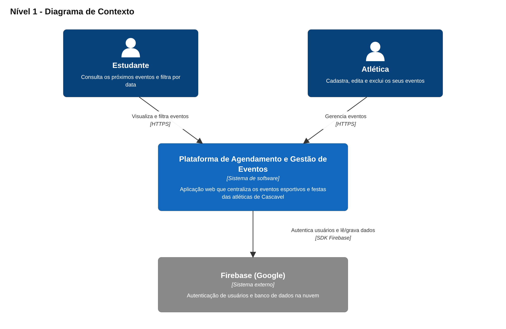
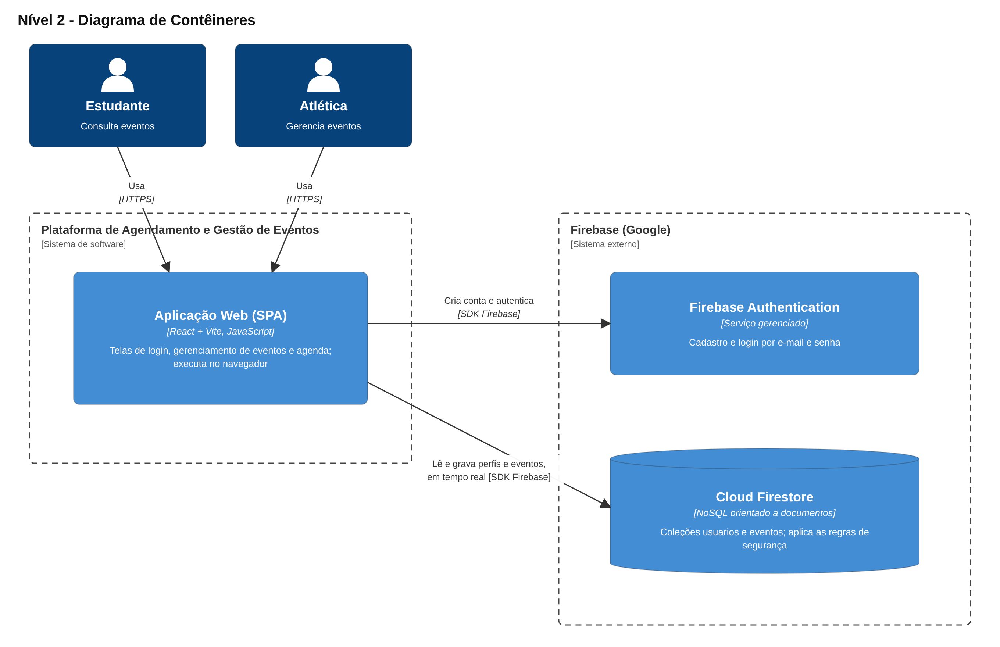
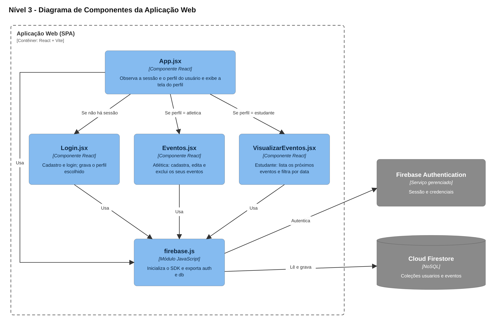
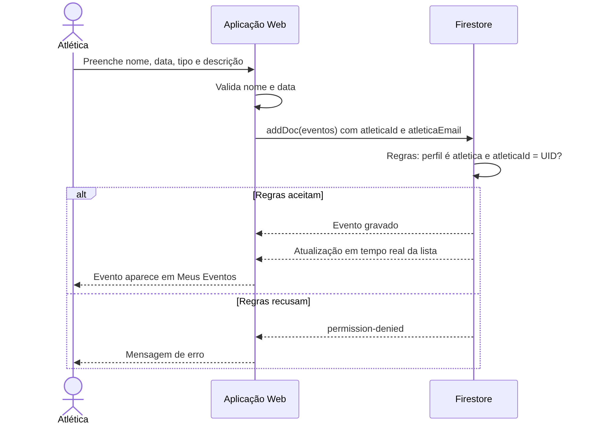

# Documentação do Sistema: Agendamento e Gestão de Eventos Esportivos

Aplicação web para centralizar o agendamento e a divulgação de eventos esportivos e festas das atléticas universitárias de Cascavel, Paraná. Trabalho de Conclusão de Curso do Tecnologia em Análise e Desenvolvimento de Sistemas, IFPR Campus Cascavel.

- **Autor:** Gabriel Albuquerque da Silva
- **Orientador:** Prof. Dr. Ricardo da Rosa
- **Repositório:** github.com/Gadsz/agendamento-eventos (privado)
- **Tecnologias:** React, Vite, Firebase Authentication e Cloud Firestore

> Esta documentação descreve a versão do sistema com autoria dos eventos (cada evento guarda a atlética que o criou).

## Sumário

1. [Visão geral](#1-visão-geral)
2. [Requisitos](#2-requisitos)
3. [Arquitetura (modelo C4)](#3-arquitetura-modelo-c4)
4. [Modelo de dados](#4-modelo-de-dados)
5. [Controle de acesso e regras de segurança](#5-controle-de-acesso-e-regras-de-segurança)
6. [Fluxos principais](#6-fluxos-principais)
7. [Decisões de arquitetura](#7-decisões-de-arquitetura)
8. [Estrutura do código](#8-estrutura-do-código)
9. [Como executar o projeto](#9-como-executar-o-projeto)
10. [Roteiro de testes](#10-roteiro-de-testes)
11. [Limitações e trabalhos futuros](#11-limitações-e-trabalhos-futuros)
12. [Como manter esta documentação](#12-como-manter-esta-documentação)

---

## 1. Visão geral

**Problema.** Cada atlética divulga seus eventos apenas no próprio perfil de rede social ou grupo de mensagens. Um estudante que quer acompanhar eventos de mais de uma atlética precisa seguir cada uma individualmente, e não existe um canal que reúna tudo.

**Solução.** Uma plataforma web centralizada em que:

- a **atlética** cadastra, edita e exclui os seus eventos;
- o **estudante** consulta, em um único lugar, os próximos eventos e filtra por data.

**Perfis de usuário.** Estudante e atlética, escolhidos no cadastro e armazenados no banco de dados.

## 2. Requisitos

| Código | Requisito funcional |
|---|---|
| RF01 | Criar conta e entrar com e-mail e senha, escolhendo o perfil de estudante ou de atlética. |
| RF02 | A atlética cadastra eventos, informando nome, data, tipo (esportivo ou festa) e descrição. |
| RF03 | A atlética edita e exclui os eventos que ela mesma cadastrou. |
| RF04 | O estudante visualiza os próximos eventos em ordem cronológica, com a atlética organizadora. |
| RF05 | O estudante filtra os eventos por data. |

| Código | Requisito não funcional |
|---|---|
| RNF01 | Acesso por navegador web, sem instalação. |
| RNF02 | Listas de eventos atualizadas em tempo real, sem recarregar a página. |
| RNF03 | Controle de acesso por perfil aplicado também no servidor (regras do Firestore). |
| RNF04 | Autenticação delegada ao Firebase Authentication; a aplicação não armazena senhas. |

## 3. Arquitetura (modelo C4)

O [modelo C4](https://c4model.com) descreve a arquitetura de software em níveis de zoom sucessivos: **Contexto**, **Contêineres**, **Componentes** e **Código**. Neste projeto os três primeiros níveis estão em diagramas. O quarto nível é opcional e está resumido em tabela na [seção 8](#8-estrutura-do-código).

### 3.1 Nível 1: Contexto

Mostra o sistema como uma caixa única, as pessoas que o usam e os sistemas externos de que depende.



| Elemento | Tipo | Descrição |
|---|---|---|
| Estudante | Pessoa | Consulta os próximos eventos e filtra por data. |
| Atlética | Pessoa | Cadastra, edita e exclui os seus eventos. |
| Plataforma de Agendamento e Gestão de Eventos | Sistema | Aplicação web que centraliza os eventos das atléticas de Cascavel. |
| Firebase (Google) | Sistema externo | Fornece autenticação de usuários e banco de dados na nuvem. |

### 3.2 Nível 2: Contêineres

Mostra as partes executáveis e os serviços de armazenamento que compõem o sistema. Aqui, "contêiner" é uma unidade que roda ou guarda dados, e não um contêiner Docker.



| Contêiner | Tecnologia | Responsabilidade |
|---|---|---|
| Aplicação Web (SPA) | React + Vite, JavaScript | Telas de login, gerenciamento de eventos e agenda; executa no navegador do usuário. |
| Firebase Authentication | Serviço gerenciado | Cadastro e login por e-mail e senha; mantém a sessão. |
| Cloud Firestore | NoSQL orientado a documentos | Guarda as coleções `usuarios` e `eventos` e aplica as regras de segurança. |

Não há servidor próprio (back-end): a aplicação conversa diretamente com os serviços do Firebase por meio do SDK, e a segurança é garantida pelas regras do Firestore.

### 3.3 Nível 3: Componentes

Detalha o interior da aplicação web.



| Componente | Responsabilidade |
|---|---|
| `App.jsx` | Observa a sessão (`onAuthStateChanged`) e o perfil do usuário (`onSnapshot` em `usuarios/{uid}`) e decide qual tela exibir. |
| `Login.jsx` | Cadastro e login por e-mail e senha; grava o perfil escolhido em `usuarios`; traduz os erros do Firebase para português. |
| `Eventos.jsx` | Tela da atlética: cadastra, edita e exclui eventos; lista somente os eventos da própria atlética. |
| `VisualizarEventos.jsx` | Tela do estudante: lista os próximos eventos em ordem de data, com filtro por data. |
| `firebase.js` | Inicializa o SDK do Firebase e exporta `auth` e `db`. |

## 4. Modelo de dados

O Firestore é um banco orientado a documentos. Há duas coleções.

**Coleção `usuarios`** (identificador do documento = UID da conta no Firebase Authentication)

| Campo | Tipo | Descrição |
|---|---|---|
| `email` | texto | E-mail da conta. |
| `tipo` | texto | `estudante` ou `atletica` (sem acento, exatamente como gravado). |

**Coleção `eventos`** (identificador gerado automaticamente)

| Campo | Tipo | Descrição |
|---|---|---|
| `nome` | texto | Nome do evento. |
| `data` | texto `AAAA-MM-DD` | Data do evento; o formato permite ordenar e filtrar por comparação de texto. |
| `tipo` | texto | `esportivo` ou `festa`. |
| `descricao` | texto | Descrição livre. |
| `atleticaId` | texto | UID da atlética que criou o evento (autoria). |
| `atleticaEmail` | texto | E-mail da atlética, exibido aos estudantes como organizadora. |

## 5. Controle de acesso e regras de segurança

O acesso é controlado em duas camadas: a interface exibe apenas a tela do perfil, e as regras do Firestore recusam no servidor qualquer operação não permitida, mesmo que alguém tente gravar por fora da interface.

| Operação | Sem login | Estudante | Atlética |
|---|---|---|---|
| Ler o próprio perfil | Não | Sim | Sim |
| Criar o próprio perfil (`tipo` válido) | Não | Sim | Sim |
| Alterar ou excluir perfil | Não | Não | Não |
| Ler eventos | Não | Sim | Sim |
| Criar evento | Não | Não | Sim, com o próprio `atleticaId` |
| Editar ou excluir evento | Não | Não | Somente os próprios eventos |

Regras publicadas no Cloud Firestore:

```
rules_version = '2';
service cloud.firestore {
  match /databases/{database}/documents {
    function ehAtletica() {
      let ref = /databases/$(database)/documents/usuarios/$(request.auth.uid);
      return request.auth != null && exists(ref) && get(ref).data.tipo == 'atletica';
    }

    match /usuarios/{uid} {
      allow read: if request.auth != null && request.auth.uid == uid;
      allow create: if request.auth != null && request.auth.uid == uid
        && request.resource.data.tipo in ['estudante', 'atletica'];
      allow update, delete: if false;
    }

    match /eventos/{id} {
      allow read: if request.auth != null;
      allow create: if ehAtletica()
        && request.resource.data.atleticaId == request.auth.uid;
      allow update: if ehAtletica()
        && resource.data.atleticaId == request.auth.uid
        && request.resource.data.atleticaId == request.auth.uid;
      allow delete: if ehAtletica()
        && resource.data.atleticaId == request.auth.uid;
    }
  }
}
```

## 6. Fluxos principais

**Cadastro e login.** O usuário informa e-mail e senha e escolhe o perfil. O Firebase Authentication cria a conta, e a aplicação grava o documento `usuarios/{uid}` com o perfil. O `App.jsx` detecta a sessão, lê o perfil e exibe a tela correspondente.

**Cadastro de evento pela atlética** (diagrama de sequência):



**Consulta pelo estudante.** A tela abre uma escuta em tempo real da coleção `eventos`, ordenada por `data`. A lista exibe apenas eventos de hoje em diante (a data de hoje é calculada no fuso local) e o campo de data filtra a lista por um dia específico.

## 7. Decisões de arquitetura

| Decisão | Motivo |
|---|---|
| Aplicação **web**, e não aplicativo móvel | Simplifica o desenvolvimento no prazo disponível e funciona em computador e celular pelo navegador. |
| **React + Vite** | Interface em componentes reutilizáveis; o Vite reduz a configuração inicial do projeto. |
| **Firebase** (Authentication + Firestore) como BaaS | Dispensa construir e manter um servidor próprio e uma API; entrega autenticação pronta. |
| Perfil guardado no Firestore e verificado pelas **regras** | A segurança não depende só da interface; o servidor recusa operações indevidas. |
| **Autoria** do evento (`atleticaId`) | Impede que uma atlética edite ou exclua o evento de outra e permite exibir a organizadora. |
| Desenvolvimento **incremental** em 4 incrementos | Trabalho individual e prazo curto: cada etapa entrega uma versão testável. |
| Sem prototipação no Figma | Decisão de projeto, dado o prazo curto; o desenvolvimento seguiu direto para o código. |

Incrementos: (1) autenticação e perfil, (2) cadastro, edição e exclusão de eventos, (3) agenda do estudante e controle de acesso, (4) filtro por data e ajustes de interface.

## 8. Estrutura do código

Código dentro de `src/` (nível 4 do C4, resumido):

| Arquivo | Funções principais |
|---|---|
| `App.jsx` | Efeito que assina `onAuthStateChanged` e `onSnapshot` do perfil; renderização por perfil (`atletica` ou `estudante`); botão Sair. |
| `Login.jsx` | `handleCadastro`, `handleLogin`, `traduzirErro`. |
| `Eventos.jsx` | `handleSalvar` (cria ou edita), `handleEditar`, `handleExcluir`, `limparFormulario`; consulta com `where("atleticaId", "==", uid)`. |
| `VisualizarEventos.jsx` | `hojeISO`, `formatarData`; consulta com `orderBy("data")`; filtros de futuros e por data. |
| `firebase.js` | Configuração do projeto Firebase; exporta `auth` e `db`. |

Os demais arquivos (`main.jsx`, `index.html`, `package.json`, `vite.config.js`) são gerados pelo Vite.

## 9. Como executar o projeto

Pré-requisitos: Node.js (versão LTS) e Git.

```bash
git clone https://github.com/Gadsz/agendamento-eventos.git
cd agendamento-eventos
npm install
npm run dev
```

O terminal mostra o endereço local (normalmente `http://localhost:5173`).

**Configuração do Firebase.** O arquivo `src/firebase.js` precisa conter as chaves do projeto `agendamento-eventos-cascavel` (console do Firebase → Configurações do projeto → Seus apps). A estrutura esperada é:

```js
import { initializeApp } from "firebase/app";
import { getAuth } from "firebase/auth";
import { getFirestore } from "firebase/firestore";

const firebaseConfig = { /* chaves do projeto Firebase */ };

const app = initializeApp(firebaseConfig);
export const auth = getAuth(app);
export const db = getFirestore(app);
```

Se o projeto Firebase for recriado, é preciso ativar o provedor **E-mail/senha** em Authentication, criar o banco Firestore e publicar as regras da [seção 5](#5-controle-de-acesso-e-regras-de-segurança).

## 10. Roteiro de testes

Teste manual com duas contas de atlética (A e B) e uma de estudante (E). Preencha a coluna "Resultado" ao executar.

| Nº | Cenário | Resultado esperado | Resultado |
|---|---|---|---|
| T01 | Criar conta de estudante e de atlética | Conta criada; cada perfil vê a sua tela | |
| T02 | Login com senha errada | Mensagem "E-mail ou senha incorretos." | |
| T03 | Atlética A cadastra evento | Evento aparece em "Meus Eventos" | |
| T04 | Atlética A edita e exclui o próprio evento | Alteração salva; exclusão pede confirmação | |
| T05 | Atlética B abre "Meus Eventos" | Não vê os eventos da A | |
| T06 | Atlética B tenta apagar evento da A por fora da interface | `permission-denied` | |
| T07 | Estudante E abre a agenda | Vê os eventos futuros de A e B, com "Organizado por" | |
| T08 | Estudante filtra por uma data | Lista apenas eventos daquele dia; "Limpar" restaura | |
| T09 | Estudante tenta gravar evento por fora da interface | `permission-denied` | |
| T10 | Evento com data passada | Não aparece na agenda do estudante | |

## 11. Limitações e trabalhos futuros

- **Perfil autodeclarado:** qualquer pessoa pode se cadastrar como atlética. O ideal é que um administrador aprove os perfis de atlética.
- **Identificação da atlética por e-mail:** não há campo de nome da atlética; incluí-lo melhoraria a exibição.
- **Filtro de eventos futuros no cliente:** a aplicação lê todos os eventos e filtra no navegador. Para volumes maiores, filtrar na consulta e paginar.
- **Datas em texto (`AAAA-MM-DD`):** simples e ordenável, mas sem horário do evento.
- **Sem notificações** de novos eventos.
- **Levantamento de requisitos por observação** dos canais de divulgação, sem entrevistas com as atléticas.
- **Hospedagem:** a documentação cobre a execução local; a publicação (por exemplo, Firebase Hosting) não faz parte do escopo atual.

## 12. Como manter esta documentação

- Os diagramas C4 estão em `diagramas/` como **SVG** (editável em draw.io ou Inkscape) e **PNG** (usado neste documento). O diagrama de sequência tem o código-fonte em Mermaid (`fluxo-cadastro-evento.mmd`), que pode ser editado e renderizado em mermaid.live.
- Ao mudar a arquitetura (novo serviço, novo componente), atualize o diagrama do nível correspondente e a tabela que o acompanha.
- Mantenha as regras da seção 5 iguais às publicadas no console do Firebase.

## Referências

- BROWN, Simon. *The C4 model for visualising software architecture*. Disponível em: https://c4model.com
- Documentação do Firebase (Authentication e Cloud Firestore): https://firebase.google.com/docs
- React: https://react.dev · Vite: https://vite.dev
